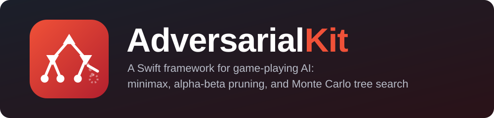
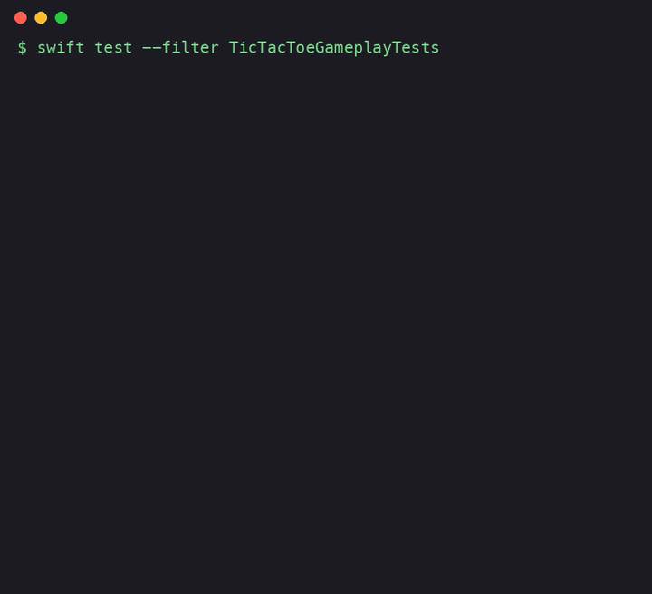

<p align="center">
  
</p>

# AdversarialKit

[](https://github.com/tkausch/AdversarialKit/actions/workflows/tests.yml)


A small, pure-Swift toolkit for turn-based, two-player games. Describe your game as a value type, and AdversarialKit finds the best move with minimax search and alpha-beta pruning, or with Monte Carlo tree search when the game is too big to search exhaustively.

- Plain Swift, no dependencies, works on any platform Swift runs on
- Value-type game models: the search never mutates shared state
- Swift 6 ready (`Sendable` throughout)
- Includes ready-made Tic-Tac-Toe, Nim and Hex models



<sub>Recording of `swift test --filter TicTacToeGameplayTests`: two minimax players play Tic-Tac-Toe to a draw. [Full-quality video](https://github.com/tkausch/AdversarialKit/blob/main/Assets/tictactoe-test.mp4).</sub>

## Installation

Add the package in `Package.swift`:

```swift
dependencies: [
    .package(url: "https://github.com/tkausch/AdversarialKit.git", branch: "main")
],
targets: [
    .target(name: "MyGame", dependencies: ["AdversarialKit"])
]
```

## Usage

### 1. Describe your game

Conform to `GameModel` (a struct works best), with your own `ModelMove` type:

```swift
import AdversarialKit

struct Place: ModelMove { let index: Int }

struct MyGame: GameModel {
    var activePlayer: ModelPlayer { ... }   // .first or .second
    var outcome: Outcome? { ... }   // nil while running; .win(player) or .draw when over
    func legalMoves() -> [Place] { ... }   // any Sequence works; lazy ones avoid allocations
    func applying(_ move: Place) -> MyGame { ... }  // return a new state
}
```

### 2. Ask for the best move

```swift
let strategist = MinimaxStrategist<MyGame>()
if let move = await strategist.bestMove(for: game) {
    game = game.applying(move)
}
```

`bestMove(for:)` is `async`. The search always runs concurrently, off the calling executor, so it never blocks the caller. It can't be cancelled; use `maxDepth` (below) to bound how long it takes.

### 3. Limit depth for bigger games

For games too large to search to the end, set a depth limit and supply a heuristic:

```swift
let strategist = MinimaxStrategist<MyGame>(maxDepth: 6) { model, player in
    // Rate the position for `player`; higher is better.
    score(of: model, for: player)
}
```

### Monte Carlo tree search

For games that are too big to search exhaustively and hard to score with a heuristic, use `MonteCarloStrategist`. It plays many random games and picks the most promising move. More `iterations` play stronger and take longer. Set a `seed` for reproducible results.

```swift
let strategist = MonteCarloStrategist<MyGame>(iterations: 5_000)
let move = await strategist.bestMove(for: game)
```

### Pitting two strategists against each other

Use `Arena` to play strategists against one another, for example to see whether a change made one stronger:

```swift
let arena = Arena<TicTacToeModel>()
let result = await arena.match(
    MinimaxStrategist<TicTacToeModel>(),
    against: MonteCarloStrategist<TicTacToeModel>(iterations: 1_000),
    rounds: 20,
    startingFrom: TicTacToeModel()
)
print(result.firstWins, result.secondWins, result.draws)
```

`match` alternates who moves first each round, so the first-move advantage doesn't skew the comparison. Use `playGame` directly for a single game.

## API overview

| Type | Purpose |
| --- | --- |
| `GameModel` | Your game: active player, outcome, legal moves, applying a move |
| `ModelPlayer` | The two players: `.first` and `.second` |
| `ModelMove` | A legal action (`Hashable`, `Sendable`) |
| `Outcome` | `.win(player)` or `.draw` |
| `Strategist` | Protocol for anything that picks a move |
| `MinimaxStrategist` | Minimax with alpha-beta pruning, optional depth limit and heuristic |
| `MonteCarloStrategist` | Monte Carlo tree search: plays random games, needs no heuristic |
| `Arena` | Plays two strategists against each other and tallies the results |
| `TicTacToeModel`, `NimModel`, `HexModel` | Ready-made games |

## Included games

`TicTacToeModel`, `NimModel` and `HexModel` are ready-made games that double as references for writing your own. Two perfect players always draw at Tic-Tac-Toe (see the test run above):

```swift
let strategist = MinimaxStrategist<TicTacToeModel>()
var game = TicTacToeModel()
while let move = await strategist.bestMove(for: game) {
    game = game.applying(move)
}
// game.outcome == .draw
```

In Nim, players take 1 to `maxTake` stones from a pile and whoever takes the last stone wins:

```swift
var game = NimModel(stones: 10, maxTake: 3)
let move = await strategist.bestMove(for: game)   // take 2, leaving a multiple of 4
```

Hex is played on a rhombus of hexagonal cells. The first player connects the top and bottom edges, the second player the left and right edges, and a game never ends in a draw. Its branching factor is high, so `MonteCarloStrategist` suits it better than exhaustive minimax:

```swift
let strategist = MonteCarloStrategist<HexModel>(iterations: 2_000)
var game = HexModel(size: 7)   // the default size is 11
while let move = await strategist.bestMove(for: game) {
    game = game.applying(move)
}
// game.outcome is .win(.first) or .win(.second)
```

## Tests

```sh
swift test
```

## License

AdversarialKit is available under the Apache License 2.0. See [LICENSE](LICENSE) for details.
